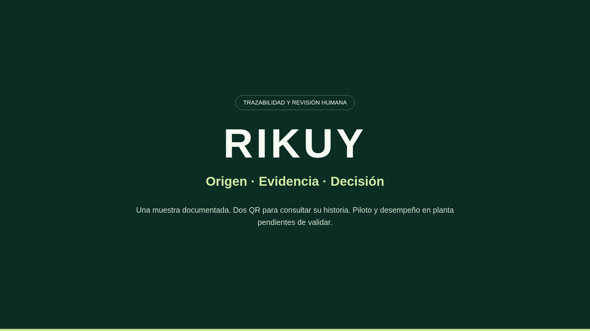

# RIKUY

MVP de inspección visual y trazabilidad de palta Hass: conecta la revisión de una muestra, la decisión de calidad y la consulta de su evidencia mediante QR.

**Tres experiencias:** inspector móvil web, dashboard de gestión y pasaporte público. El inspector es una web responsive, no una aplicación nativa.



[Ver la demo de dos minutos](demo-video/README.md) · [Propuesta y alcance](docs/producto.md) · [Arquitectura](docs/arquitectura.md)

## Recorrido

Seleccionar lote → cargar y revisar fotografía → analizar → revisar resultado → confirmar clasificación o retener → consultar historial → publicar pasaportes.

- **Inspector:** fotografía original y analizada, ampliación, madurez experimental y revisión humana con motivo.
- **Dashboard:** inspecciones, filtros, evidencia, mediciones manuales, CSV y ficha productiva del lote.
- **Pasaportes:** QR individual de inspección y QR estable del lote, con historial confirmado y consulta sin credenciales.
- **Lector público:** cámara, archivo de imagen del QR o enlace pegado.

## Stack

| Capa | Tecnología |
| --- | --- |
| Interfaz | React 19, TypeScript, Vite, CSS, Lucide |
| API local | Node.js 22, persistencia JSON y archivos |
| Visión experimental | Python, Ultralytics, inferencia CPU |
| Publicación | Vercel y Supabase Postgres/Storage |
| Pruebas | Node Test Runner, Playwright, unittest |

## Ejecutar localmente

Requiere **Node.js 22** y npm. Desde la raíz:

```bash
npm ci
npm run dev
```

Abre `http://localhost:5173`. El servidor de API usa el puerto 3001. Sin los pesos locales puedes explorar el camino identificado como demostración; analizar una foto nueva requiere [configurar los modelos](ml/README.md). Un fallo del modelo no se reemplaza por una predicción ficticia.

| Ruta | Experiencia |
| --- | --- |
| `/inspector` | Inspección y consulta del historial |
| `/dashboard` | Gestión local |
| `/dashboard/lotes` | Ficha productiva y publicación del lote |
| `/consultar` | Lector público de QR |
| `/p/<id>` | Pasaporte de una inspección confirmada |
| `/l/<id>` | Pasaporte de lote |

Para ejecutar la compilación:

```bash
npm run build
npm start
```

Abre `http://localhost:3001`. Los registros y fotografías se conservan en `.data/`, excluido de Git. No borres esa carpeta si necesitas conservar inspecciones.

## Publicar los reportes

El análisis y la gestión se ejecutan en la laptop. Vercel sirve el lector y los pasaportes; Supabase conserva una copia pública de los campos aprobados y sus fotografías en almacenamiento privado con enlaces firmados. Los reportes publicados no dependen de que la laptop siga encendida.

Sigue [la guía de despliegue](deployment/GRATUITO.md). Usa `.env.example` como plantilla para un `.env` local y configura `PUBLIC_BASE_URL` con tu dominio HTTPS. Para cargar ese archivo:

```bash
node --env-file=.env scripts/dev.mjs
```

Las claves Supabase son exclusivas del servidor. El despliegue de Vercel no incluye la API administrativa ni los modelos Python. Las rutas internas del servidor local todavía no tienen autenticación: mantén esa instancia en un entorno controlado.

## Modelos y límites

- **Madurez Hass:** cinco etapas, particiones agrupadas por fruto. Exactitud interna de test del modelo activo: **79,1 %**; no es validación externa en planta. [Informe y procedencia](ml/RESULTADO_HASS.md).
- **Condiciones visibles:** segmentación experimental. Las máscaras delimitan frutos completos; no equivalen a área dañada ni a conteo total. No hay clase sana y la alerta `Suffocation` requiere revisión.
- **Clasificación comercial:** decisión humana A/B/C o retención. El sistema no decide la aptitud de exportación.
- **Mediciones:** conteo, defectos observados y diámetro pueden registrarse manualmente con procedencia. Los valores no medidos permanecen ausentes.
- **Logística:** escenarios ilustrativos de duración y traslado, separados de las predicciones y excluidos del pasaporte público. No son vida útil validada.

No se infieren peso, textura al tacto, calidad de pulpa, semilla ni estándares de packing desde una fotografía. La sesión, lotes y ejemplos de presentación están identificados como demostración.

## Pruebas y demo en vivo

```bash
npm test
npx playwright install chromium
npm run test:e2e
```

Las pruebas de API usan almacenamiento temporal y no publican datos reales. Las de navegador incluyen inferencia y requieren los modelos locales, Python y Chromium.

El [kit de demo en vivo](tests/fixtures/demo-en-vivo/README.md) contiene cinco imágenes atribuidas, salidas comprobadas, casos de incertidumbre y un error conocido. Son ejemplos seleccionados, no una evaluación imparcial de exactitud.

```bash
ml/.venv/bin/python scripts/verificar-demo.py
```

## Estructura

```text
apps/web/       Interfaz y componentes
server/         API local, inferencia y publicación
api/            Función de consulta para Vercel
ml/             Herramientas, pruebas e informes de visión
scripts/        Arranque, publicación y verificación de demo
tests/          API, navegador y fotografías de prueba
deployment/     SQL y guía de despliegue
docs/           Producto, arquitectura y guion de demo
demo-video/     Video final, subtítulos y reproductor
notebooks/      Cuaderno de entrenamiento experimental
```

Datasets, pesos, entornos Python, claves, datos de ejecución y archivos intermedios están excluidos del repositorio. Los pesos no se descargan automáticamente: una copia nueva del proyecto requiere prepararlos por separado. Consulta [las atribuciones](THIRD_PARTY_NOTICES.md).
