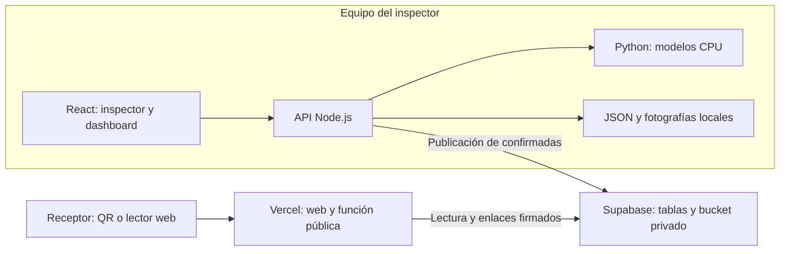

# Arquitectura

## Dos entornos

## Responsabilidades

- `apps/web/src/`: experiencias de inspector, gestión y consulta; comparte contratos y componentes.
- `server/index.mjs`: rutas locales y persistencia bajo `DATA_DIR` o `.data/`.
- `server/analysis.mjs`: valida disponibilidad y ejecuta `agrotrace.predict` en CPU. Admite un análisis simultáneo y limita el tiempo a 60 segundos; conserva la captura al fallar.
- `server/lot-traceability.mjs`: ficha productiva y representación pública del lote.
- `server/cloud-passports.mjs`: publica campos autorizados y fotografías; firma enlaces de lectura. No envía notas privadas ni simulaciones logísticas.
- `server/logistics.mjs`: reglas ilustrativas, independientes de mediciones y decisión comercial.
- `api/passport.mjs`: función pública de consulta para Vercel.
- `vercel.json`: compilación y rutas públicas. La raíz dirige al lector QR.

## Persistencia e identificadores

Cada inspección comienza pendiente. Al confirmarla recibe un identificador público; una inspección retenida no genera pasaporte. Una confirmación no se repite y los reintentos de creación reutilizan el identificador de solicitud.

El lote conserva su identificador público estable. Su pasaporte presenta la ficha actual y el historial confirmado; el pasaporte individual conserva el resultado de la muestra y consulta la ficha actual del lote. La ficha no equivale a una instantánea histórica inmutable de la producción.

Supabase utiliza las tablas `agrotrace_passports` y `rikuy_lot_passports` y el bucket privado `agrotrace-passports`. Estos identificadores se conservan por compatibilidad con registros existentes. Los enlaces firmados de fotografías pueden renovarse sin cambiar el QR.

## Configuración

`.env.example` enumera las variables. Node carga `.env` solo cuando se inicia con `--env-file=.env`; no se copia a la interfaz. `PUBLIC_BASE_URL` define el dominio utilizado en los QR. Los secretos Supabase se usan únicamente en procesos de servidor.

`ML_PYTHON`, `MODEL_DIR` y `RIPENESS_MODEL_DIR` permiten sustituir ejecutable y modelos. El modelo de madurez preferido es `hass-mendeley-active`, con respaldos locales si existen. Cada resultado registra la versión realmente utilizada; los registros anteriores no se recalculan.

## Límites operativos

La API administrativa todavía carece de autenticación y autorización. El archivo JSON sirve al prototipo local; no es una base multiinstancia. Vercel no ejecuta el servicio local de inferencia ni expone las rutas administrativas. La disponibilidad pública depende de la configuración y cuotas de los proveedores.

Las pruebas automatizadas no sustituyen una comprobación con teléfono físico, permisos de cámara y red del evento. Consulta [despliegue](../deployment/GRATUITO.md) y [kit de ensayo](../tests/fixtures/demo-en-vivo/README.md).
